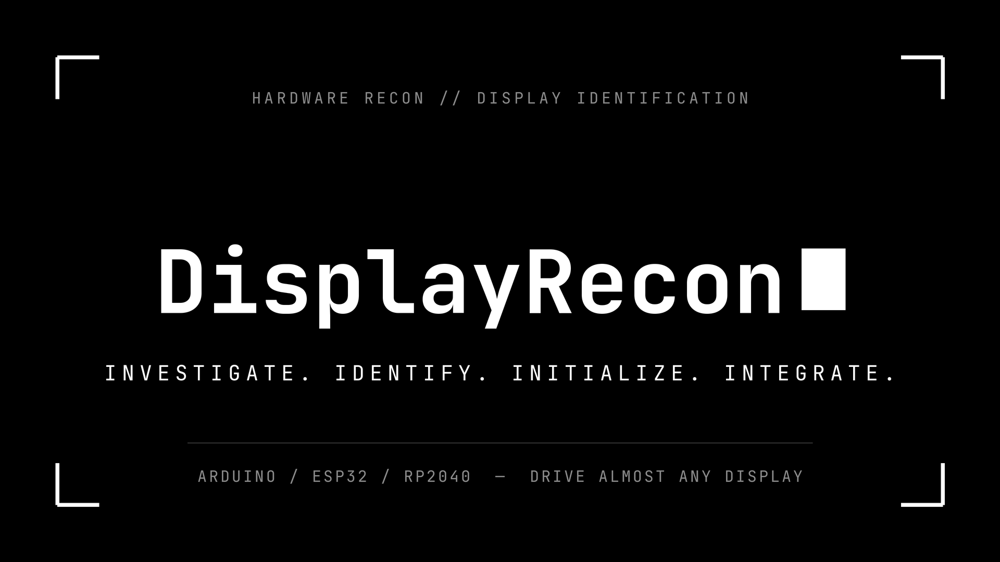

<p align="center">
  
</p>

# DisplayRecon

**Investigate. Identify. Initialize. Integrate.**

An agent skill for figuring out how to drive almost any display on Arduino and other microcontroller platforms — from the ubiquitous SSD1306 OLED to obscure VFD modules, undocumented LCD controllers, custom LED panels, and interfaces nobody has documented.

DisplayRecon is not an Arduino code generator. It is a **hardware research, diagnostics, and implementation specialist** that turns incomplete hardware information into a verified, working display implementation through systematic investigation and efficient experimentation.

Works with any capable LLM agent — Claude Code, Claude Desktop, OpenCode, or any harness that loads markdown skills.

---

## The problem it solves

Ask a generic AI assistant to help with a display and it will guess: "It's probably an SSD1306, here's some code." When that code does nothing — which is likely, because the module was actually an SH1106 with a 2-pixel column offset — it regenerates everything and guesses again.

DisplayRecon is built to break that loop:

1. **Never assume the controller from appearance.** Identification is evidence-based and confidence-graded (Confirmed / Strongly supported / Possible / Unknown). A guess is never presented as a spec.
2. **Never invent pinouts, register addresses, or init sequences.** Primary sources (datasheets, app notes, manufacturer code) come first; established libraries come before hand-rolled drivers.
3. **One experiment, one hypothesis.** Every failed experiment is recorded, eliminates a hypothesis, and feeds the next attempt. No experiment is ever repeated without a changed hypothesis.
4. **Never regenerate the whole project.** Working code is preserved; only the failing part is patched.
5. **Verified beats compiling.** Output is graded across five explicit levels — from *Compilation Verified* up to *Hardware Verified* — and it never claims a level the evidence doesn't support.

## What it handles

| Technology | Examples |
|---|---|
| OLED | SSD1306, SH1106, SSD1309, SSD1327, SSD1351 |
| TFT LCD | ST7735, ST7789, ILI9341, ILI9488, GC9A01 |
| Character LCD | HD44780 + clones, PCF8574 I2C backpacks, native-I2C ST7032/ST7036 |
| VFD | Noritake, Futaba, NEC driver ICs, serial/parallel/custom, unknown controllers |
| LED displays | MAX7219/7221, TM1637, HT16K33, WS2812B, HUB75 matrices, custom multiplexed |
| Other | E-paper (SSD1608, IL3820, UC8151...), segmented, legacy (T6963C, KS0108), undocumented hardware |

Boards: Arduino Uno / Mega / Nano / Nano Every / Nano ESP32, ESP32 (S2/S3/C3/C6), Raspberry Pi Pico / RP2040 / RP2350, and other Arduino-compatible platforms — with the platform-specific differences (logic voltage, pin mapping, RAM limits, DMA/RMT/PIO peripherals) built into its platform reference.

This list is orientation, not a taxonomy. An unfamiliar display is never forced into a category.

## Installation

DisplayRecon is a directory of markdown files — no scripts, no dependencies.

### Claude Code / Claude Desktop

```bash
git clone https://github.com/SkorpioX22/DisplayRecon.git ~/.claude/skills/DisplayRecon
```

Windows (PowerShell):

```powershell
git clone https://github.com/SkorpioX22/DisplayRecon.git "$env:USERPROFILE\.claude\skills\DisplayRecon"
```

### OpenCode

OpenCode discovers skills from `~/.claude/skills`, so the same command works. Alternatively place it under your OpenCode skills directory and reference it in your agent config.

### Any other agent

Any harness that can read markdown as context can use DisplayRecon: point it at `SKILL.md` and instruct it to consult files in `references/` and `templates/` when the relevant topic comes up. The skill deliberately uses progressive disclosure so smaller-context models load only what they need.

## Usage

No special commands. Mention your display and the skill triggers:

- *"I have an SSD1306 OLED and an ESP32-S3."* → gathers exact module specs, establishes wiring, picks libraries, produces a minimal init test, then progresses toward functional output.
- *"I found an old VFD display with 16 pins and no markings."* → requests targeted photographs, researches controller candidates, establishes electrical requirements, refuses to assume a standard interface.
- *"The display is completely blank."* → works the failure-layer ladder (power → wiring → communication → init...), runs one targeted diagnostic experiment, preserves working code.
- *"There's no datasheet anywhere."* → checks for rebadges, hunts the controller IC marking, examines similar modules and open-source drivers, builds a cautious investigation plan.

### Example session flow

```
You:  I found a VFD module in a junk box, 14 pins, no model number.
DR:   Requests photos: front glass, back PCB (markings), connector close-up.
      You send photos → silk shows "GU-1406-01A" → research: Noritake GU-7000 family,
      UART command set, 38400 baud default → Confirmed identification with source.
DR:   Electrical check: module is single-supply 5 V with onboard drivers;
      your ESP32 TX at 3.3 V needs verification against V_IH → recommends divider.
DR:   Writes a minimal 20-line sketch sending the GU-7000 clear-screen command.
      You report: displays "OK" → Communication Verified.
DR:   Progresses: text mode → custom glyphs → brightness commands → your app.
```

## How it works

The skill runs a four-phase workflow:

1. **Intake** — a compact, grouped interview (see `templates/hardware-intake.md`) that asks only for what research can't answer, and requests photographs when markings are decisive.
2. **Identification & research** — a strict source hierarchy (datasheet → app note → controller docs → manufacturer code → libraries → community), with every identification confidence-graded (`references/controller-research.md`).
3. **Implementation** — never skips Phase A (electrical compatibility): voltage, current, level shifting, power sequencing are verified *before* any wiring is suggested. Then minimal init → progressive functionality (`references/electrical-safety.md`, `references/arduino-platforms.md`, `references/library-evaluation.md`).
4. **Diagnostics** — symptom → failure-layer tables, one-target experiment menu, and the anti-repeat rule: every attempt is recorded with hypothesis, change, result, and conclusion (`references/diagnostic-methodology.md`).

Throughout, the agent maintains an **Investigation State** (`templates/investigation-state.md`) — a compact record of confirmed facts, open questions, experiments, and failed approaches. Paste it into a new conversation and the investigation continues where it left off instead of restarting.

## Repository layout

```
DisplayRecon/
├── SKILL.md                          # Core instructions (loaded by the agent)
├── references/
│   ├── display-technologies.md       # Controller families, quirks, variants
│   ├── communication-protocols.md    # I2C/SPI/UART/parallel + unknown-interface discrimination
│   ├── controller-research.md        # Identification procedure, source hierarchy, no-datasheet fallback
│   ├── electrical-safety.md          # Logic levels, current, VFD high-voltage, safe measurement
│   ├── arduino-platforms.md          # Per-board differences, RAM budgeting, peripherals
│   ├── diagnostic-methodology.md     # Symptom→layer tables, experiment menu
│   └── library-evaluation.md         # Library selection, family map, bare-metal fallback
└── templates/
    ├── hardware-intake.md            # Interview checklist + question snippets
    ├── investigation-state.md        # Persistent experiment-tracking block
    └── verification-checklist.md     # 12-item checklist + verification levels
```

## Verification levels

DisplayRecon never says "it works" without evidence. Every claim is graded:

| Level | Requires |
|---|---|
| **Compilation Verified** | Successful build only |
| **Communication Verified** | Acknowledged traffic between MCU and display |
| **Initialization Verified** | Display responds correctly to init |
| **Functional Verified** | Required features demonstrably work |
| **Hardware Verified** | Tested on the actual physical hardware |

## Safety

Display enforces electrical safety throughout: 3.3 V vs 5 V logic incompatibilities, supply current reality checks (HUB75 panels and WS2812B strips are not dev-board-regulator territory), negative/boost rails on VFD and e-paper hardware, and explicit refusal to instruct probing of unidentified high-voltage connections. See `references/electrical-safety.md`.

## Contributing

Issues and pull requests welcome — especially reports of display modules where the reference tables were wrong or incomplete. See [CONTRIBUTING.md](CONTRIBUTING.md).

## License

[MIT](LICENSE)
